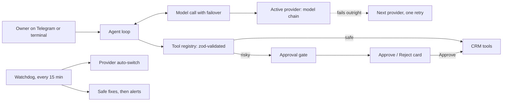

# ops-agent

[](https://github.com/Bestro4u/ops-agent/actions/workflows/ci.yml)

A Telegram operations agent for a small outbound sales team. You chat with it; it works the CRM through tools. It keeps running when an AI provider fails, it cannot delete or bulk-edit anything without a person tapping Approve, and it fixes small faults by itself before it bothers anyone.

I run my own outreach from a bot like this. The production version talks to my live CRM and client systems, so it stays private. This repo is its core, rebuilt to run on its own with a demo CRM of fictional companies.

## Try it in two minutes

You need Node 22 or newer and one model key. A free [Google Gemini key](https://aistudio.google.com/apikey) is enough.

```bash
git clone https://github.com/Bestro4u/ops-agent.git
cd ops-agent
npm install
cp .env.example .env        # then paste your key after GEMINI_API_KEY=
npm run chat
```

Then try:

- `what's due today?`
- `log an email to L-002` (refused if it's outside that lead's working hours)
- `delete L-005, it's a duplicate` (queued; you're asked to approve)
- `mark L-001 to L-012 as lost` (more than 10 leads, so it needs approval too)
- `/check` runs the watchdog once

To run it as a Telegram bot, add `TELEGRAM_BOT_TOKEN` and your numeric `OWNER_CHAT_ID` to `.env` and run `npm start`.

## How it fits together



| Folder | What it does |
|---|---|
| `src/agent` | The loop: ask the model, run the tools it asks for, repeat. Warns the model as its step budget runs down. |
| `src/llm` | Providers (Gemini, OpenRouter, OpenAI), failover across models and providers, and the auto-switch. |
| `src/gate` | The approval gate. Risky actions wait here until a person approves. |
| `src/tools` | The tool registry and the CRM tools. |
| `src/crm` | The demo CRM and the working-hours rules (time zones, weekends, public holidays). |
| `src/watchdog` | Health checks, automatic fixes and the alert policy. |

## Design decisions, and the incidents behind them

**Approval is enforced in code, not asked for in the prompt.** Early on, the only thing stopping my bot from sending, publishing or changing records was a line in its system prompt. A prompt can be argued with. Now a risky tool never runs its action: it saves a pending request and sends an Approve / Reject card. The action runs only from that button. It runs at most once (the record is marked approved before the action starts) and requests expire after 24 hours. Some tools are gated by their arguments: changing 3 leads runs straight away, changing 11 waits for approval.

**Two layers of failover.** Inside a provider, a 429 or 5xx moves the call to the next model in the chain. If the provider fails outright, the call is retried once on the next provider that has a key. I added the second layer after my main model provider failed twice in one month (once a lapsed plan, once a changed API requirement) and every reply failed until I noticed.

**The agent switches provider by itself, and switches back.** One provider once started taking 15 to 20 seconds to answer a one-word ping. The per-call fallback still worked, but every reply waited for the slow provider first. Now each watchdog sweep pings the active provider. If it is down or slow, the agent moves to the first healthy one and remembers where it came from. It moves back only after the original answers fast twice in a row. If a person picks a provider with `/provider`, that choice wins.

**A quiet watchdog.** My first watchdog messaged on every failed check and again on every recovery. People stop reading alerts like that. Now a first failure gets an automatic fix and no message. A second failure means the fix didn't hold, so it sends one message. A third escalates once, then it stays quiet until the check recovers, and it only says "working again" to someone who was told it was down.

**Rules the model can't talk its way around.** Touches can only be logged inside the lead's own working hours, in the lead's time zone, skipping weekends and that country's public holidays. A team in Lagos writing to Chicago and London needs three different windows. These are pure functions with their own tests, so the tool and the test run the same code.

**One schema per tool.** Each tool's input is a zod schema. It gives the model its JSON Schema and gives the code its validator. Bad input goes back to the model as an error it can fix, never as a crash.

## Tests

```bash
npm test          # 54 tests
npm run typecheck
```

They cover the failover order, the auto-switch and switch-back, the approval gate (runs once, never on reject, expires), the registry, the agent loop and its budget warnings, the watchdog's alert policy, working hours across time zones and daylight saving, the CRM tools, and a full run from request to approval to delete. CI runs them on Node 22 and 24.

## Trade-offs

- **State is one JSON file.** It keeps the repo free of native modules so it installs anywhere. Fine for one bot process; the production version uses a database.
- **One owner.** The bot answers one Telegram user and sends every approval to them. A team would need roles and more than one approver.
- **No streaming.** Replies arrive whole. For a chat bot doing short tool work, that has been fine.

## What I'd add next

- An evaluation set of real requests, to catch a model update that starts picking the wrong tool.
- A Postgres store, so the bot and a web app can share approvals.
- Approvals that name who approved, for an audit trail.

## How I build

With Claude Code. I decide what gets built and why, and every behaviour is pinned by a test, so I can check what the agent wrote instead of trusting it.

## Licence

All rights reserved. You're welcome to read and run this code to judge my work. Please ask before reusing it.
